# BurgerMash 🍔

[](https://github.com/Eccekurtt/burgermash/actions/workflows/ci.yml)
[](https://burgermash.vercel.app)


Elle ezilen burger konseptiyle yapılmış, **uçtan uca bir full stack sipariş uygulaması**: animasyonlu bir vitrin, gerçek zamanlı sipariş takibi, mutfak ekranı ve admin paneli. Canlıda çalışıyor, otomatik testlerle korunuyor.

> **English summary:** BurgerMash is a full-stack burger ordering app built as a portfolio project. Customers customize burgers and combos, order as guests or members, and follow their order live over WebSockets. Kitchen staff get a real-time board and admins manage prices and stock. Next.js 16 + NestJS 12 + PostgreSQL (Prisma), server-side pricing, role-based access, bilingual UI (TR/EN), installable PWA, 59 automated tests, Dockerized, deployed on Vercel + Render + Neon. Live demo below.

> **Kurgusal bir portföy projesidir.** Markası, menüsü ve fiyatları uydurmadır; gerçek ödeme alınmaz, gerçek sipariş hazırlanmaz.

<p align="center">
  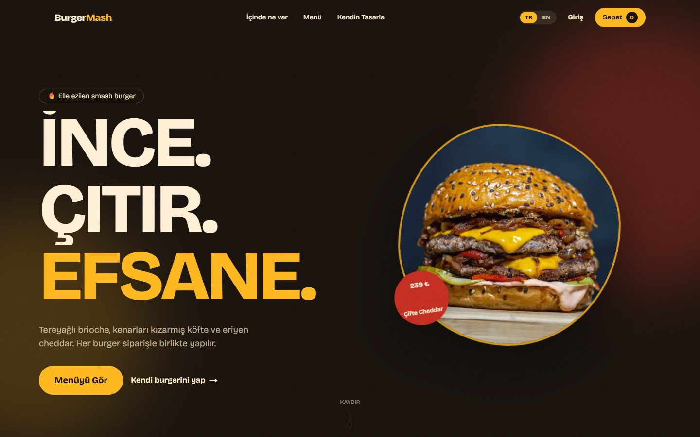
</p>

## Canlı demo

- **Site:** <https://burgermash.vercel.app>
- **API dokümantasyonu (Swagger):** <https://burgermash-api.onrender.com/docs>

> API ücretsiz katmanda çalıştığı için bir süre kullanılmazsa uykuya geçer; ilk açılış 50 saniyeye kadar sürebilir (bu sırada site yerleşik örnek menüyle açılır). Yayındaki admin ve mutfak hesaplarının şifreleri gizlidir; aşağıdaki demo hesapları yalnızca yerel geliştirme içindir.

## Ekran görüntüleri

### Açılış animasyonu
Sayaç 100'e çıkarken burger düşer; ardından ekranı dolduran devasa bir burger katman katman çakılır, döner ve site ortadan açılır.

<table>
  <tr>
    <td>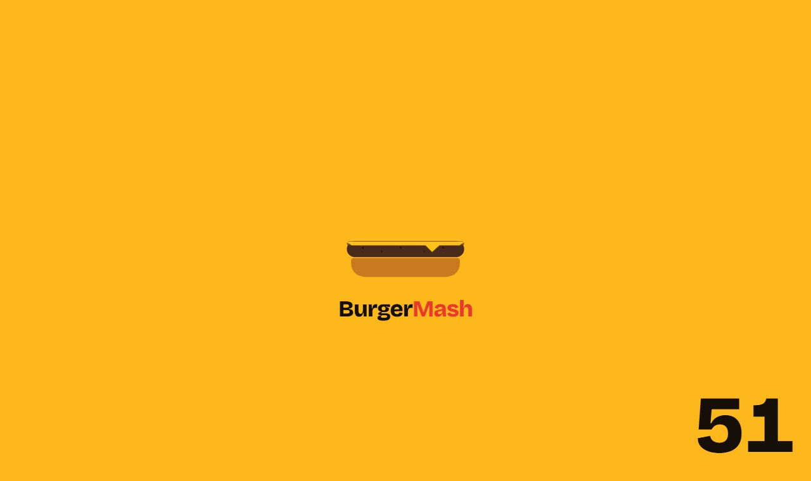</td>
    <td>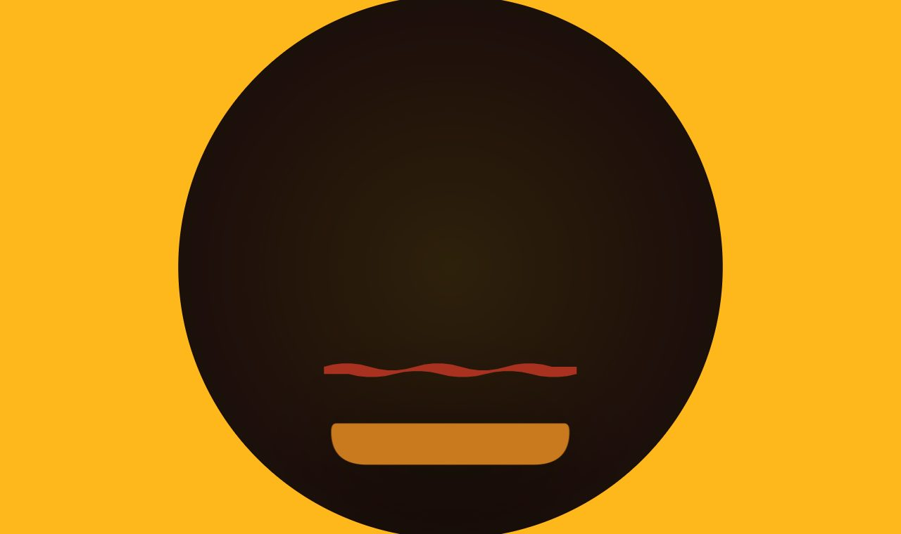</td>
    <td>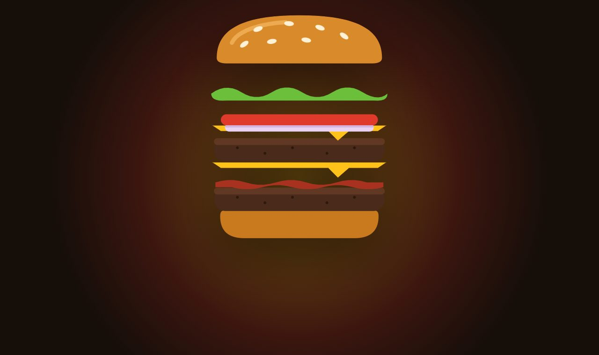</td>
  </tr>
</table>

### Müşteri deneyimi

<table>
  <tr>
    <td width="50%">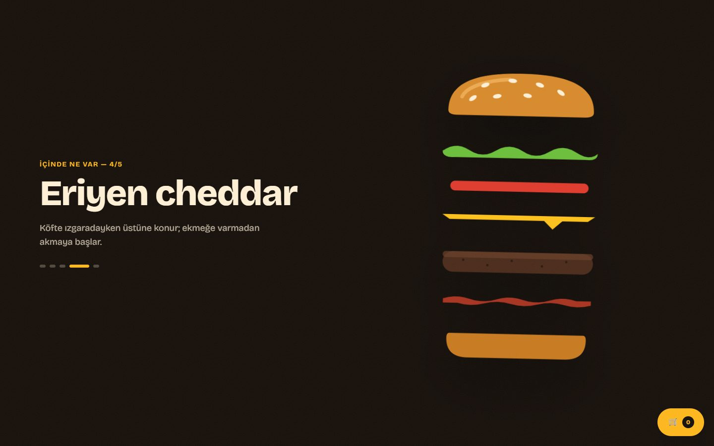<br><sub><b>Kaydırdıkça ayrışan burger</b>, her katmanın hikâyesi yanında değişir</sub></td>
    <td width="50%">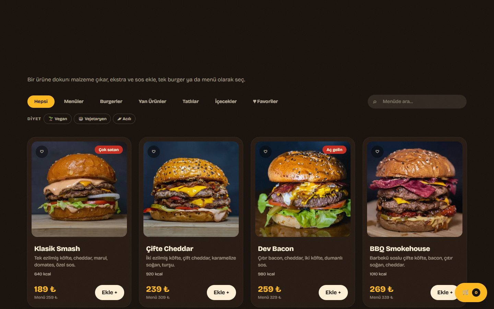<br><sub><b>Menü:</b> kategori, arama, favoriler, vegan/vejetaryen/acılı filtreleri, kalori bilgisi</sub></td>
  </tr>
  <tr>
    <td>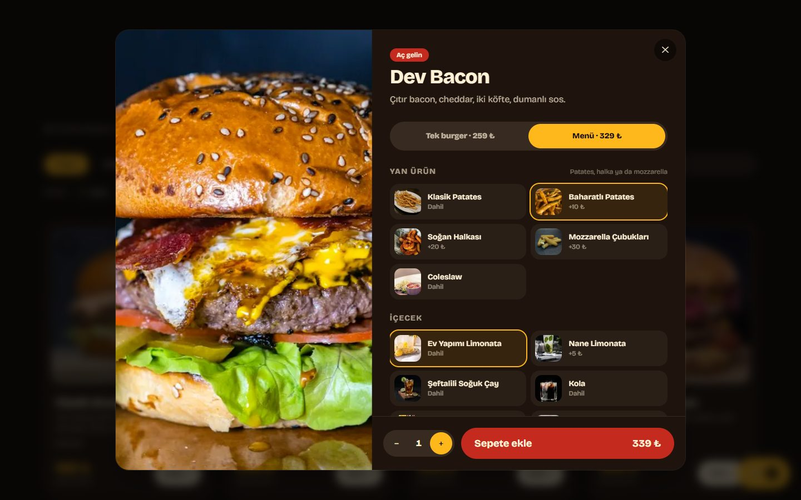<br><sub><b>Ürün penceresi:</b> malzeme çıkar, ekstra ve sos ekle, tek burger ya da menü seç, menüde tasarruf hesabı</sub></td>
    <td>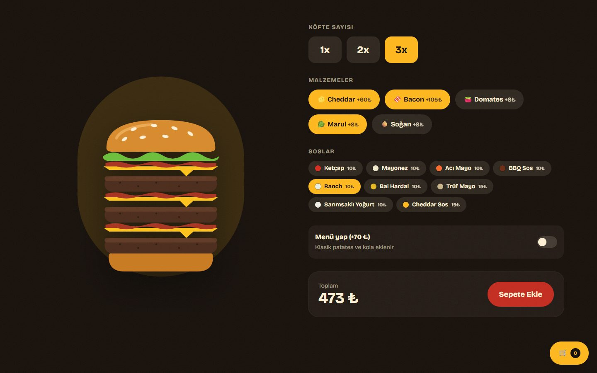<br><sub><b>Kendin tasarla:</b> köfte sayısı ve malzemelerle canlı çizilen burger, anlık fiyat</sub></td>
  </tr>
  <tr>
    <td>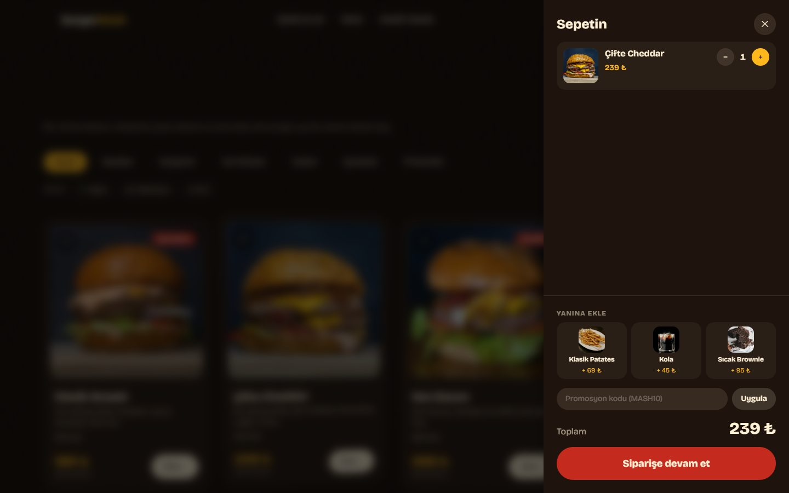<br><sub><b>Sepet:</b> "yanına ekle" önerileri, promosyon kodu</sub></td>
    <td><br><sub><b>Türkçe / İngilizce:</b> menü içeriği, sepet ve sipariş detayları seçilen dilde</sub></td>
  </tr>
</table>

### Mobil (PWA olarak telefona eklenebilir)

<table>
  <tr>
    <td>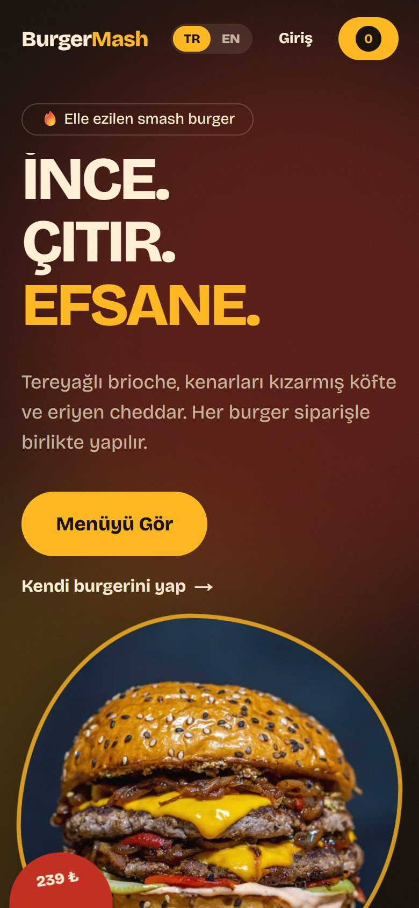</td>
    <td>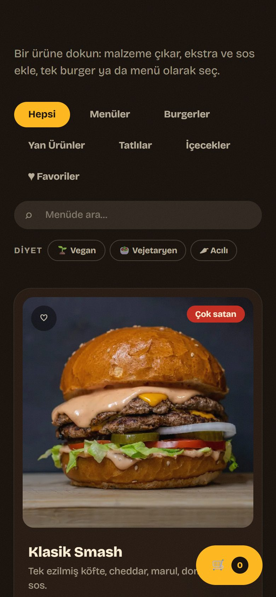</td>
  </tr>
</table>

### Sipariş takibi, mutfak ve yönetim

> Bu üç ekran, **uydurma demo siparişlerle yerel ortamdan** alınmıştır; gerçek müşteri verisi içermez.

<table>
  <tr>
    <td width="50%">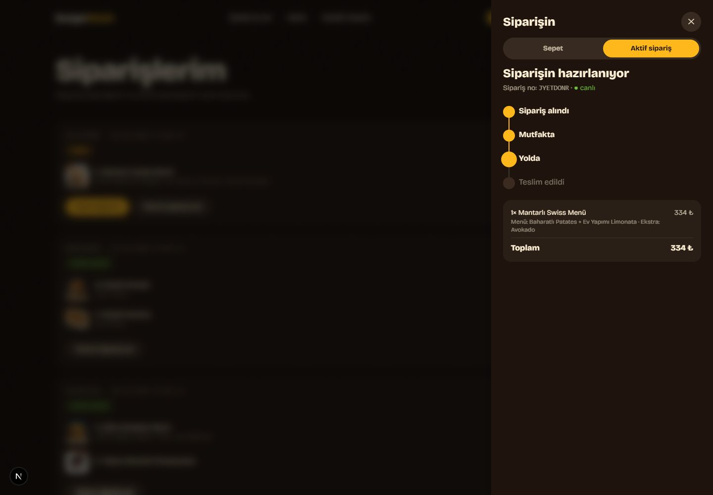<br><sub><b>Canlı takip:</b> WebSocket ile, mutfak durumu değiştirince sayfa yenilenmeden güncellenir</sub></td>
    <td width="50%">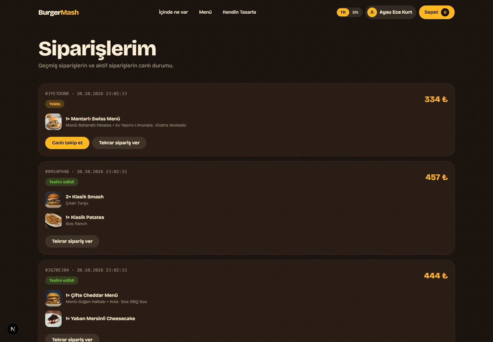<br><sub><b>Siparişlerim:</b> geçmiş, canlı takip ve "tekrar sipariş ver"</sub></td>
  </tr>
  <tr>
    <td>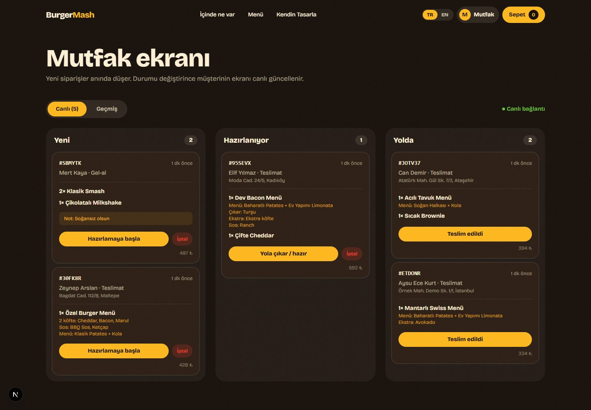<br><sub><b>Mutfak ekranı:</b> yeni siparişler anında düşer (sesli bildirim), üç sütunlu akış</sub></td>
    <td>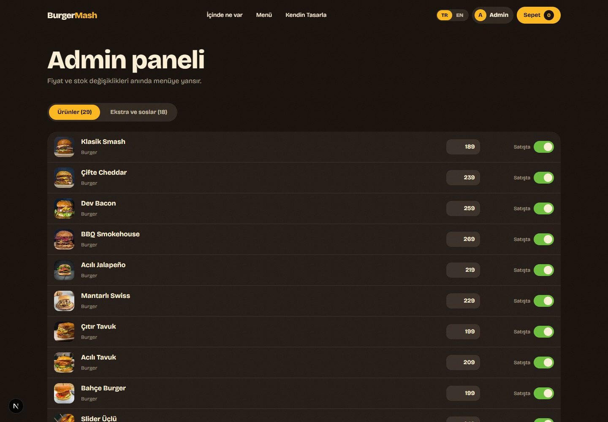<br><sub><b>Admin paneli:</b> fiyat ve stok değişikliği anında menüye yansır</sub></td>
  </tr>
</table>

## Neler var?

**Müşteri**
- Animasyonlu açılış, kaydırmayla ayrışan burger, 3B eğilen kartlar (Framer Motion + Lenis)
- **Türkçe / İngilizce** arayüz (tarayıcı diline göre otomatik, dil düğmesiyle değiştirilebilir). Sepet ve sipariş detayları ham seçimlerden seçili dilde üretilir
- 29 ürünlük menü: kategori filtresi, arama, favoriler, **vegan / vejetaryen / acılı filtreleri**, kalori ve alerjen bilgisi
- Ürün detay penceresi: **malzeme çıkar, ekstra ve sos ekle, tek burger ya da menü** (patates + içecek) seç
- "Kendin tasarla": köfte sayısı ve malzemelerle canlı burger oluşturucu
- Sepet ("yanına ekle" önerileri), promosyon kodu, teslimat / gel-al, **WebSocket ile canlı sipariş takibi**
- **PWA**: telefona uygulama gibi eklenebilir, çevrimdışıyken önbellekten açılır
- Kayıt/giriş, sipariş geçmişi, "tekrar sipariş ver"

**Personel**
- **Mutfak ekranı** (`/mutfak`, rol: mutfak ya da admin): yeni sipariş anında düşer, durumlar düğmeyle ilerletilir, iptal edilebilir
- **Admin paneli** (`/admin`, rol: admin): ürün, ekstra ve sos fiyatları ile stok durumu; değişiklik anında menüye yansır

| Rol | Sipariş görme ve ilerletme | Menü ve fiyat yönetimi |
|---|---|---|
| Müşteri | yalnızca kendi siparişleri | ❌ |
| Mutfak | ✅ | ❌ |
| Admin | ✅ | ✅ |

## Teknoloji

| Katman | Teknoloji |
|---|---|
| Ön yüz | Next.js 16 (App Router), React 19, TypeScript, Tailwind CSS 4, Framer Motion, Lenis |
| Arka yüz | NestJS 12 (modüler monolit), TypeScript, Prisma 7, socket.io, JWT, class-validator, Swagger |
| Veritabanı | PostgreSQL |
| Test | Vitest (birim + API e2e), Playwright (tarayıcı e2e) |
| Altyapı | Docker (Dockerfile'lar + Compose), GitHub Actions CI, yayın: Vercel (site) + Render (API, Docker) + Neon (PostgreSQL), hepsi ücretsiz katman |

## Mimari

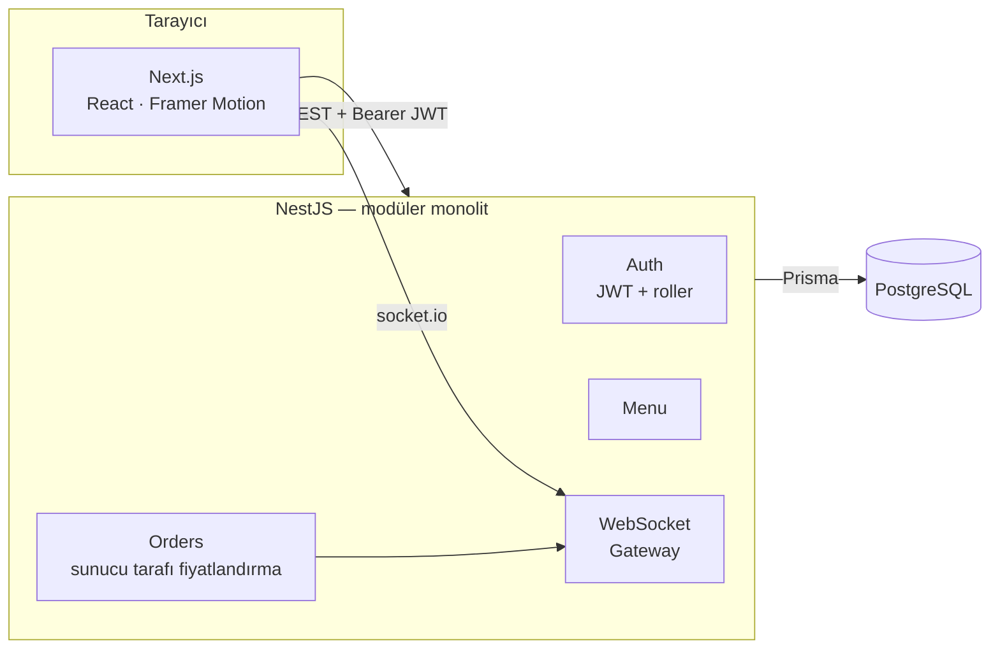

**Canlı ortam:** site Vercel'de, API Render'da (Docker imajı), veritabanı Neon'da çalışır.

### Önemli tasarım kararları

- **Fiyat her zaman sunucuda hesaplanır.** İstemci yalnızca ham seçimleri gönderir (ürün, malzemeler, soslar…). Fiyat alanı gönderilirse istek reddedilir. Kurallar saf fonksiyonlarda ([`api/src/orders/pricing.ts`](api/src/orders/pricing.ts)) olduğu için veritabanı olmadan test edilir.
- **Durum makinesi:** `Alındı → Hazırlanıyor → Yolda → Teslim edildi` (ya da iptal). Geri dönmek veya atlamak reddedilir.
- **Gerçek zamanlı kanal gizliliği:** Mutfak odası tüm siparişi (adres, telefon) görür; müşteri odası yalnızca kendi siparişinin, kişisel veriler çıkarılmış hâlini alır.
- **Modüler monolit:** Auth, Menu ve Orders modülleri ayrı; ileride servislere ayrılabilir. Ücretsiz hosting'de tek süreç olarak çalıştırmak çok daha basit.
- **Zarif bozulma:** API'ye ulaşılamazsa ön yüz yerleşik örnek menüyle açılır ve bunu belirtir (ücretsiz sunucular uyuyabilir).
- **Sepet ham seçimleri tutar:** Ad ve detaylar gösterim sırasında seçili dilde üretilir; böylece dil değişince sepet, takip ve geçmiş siparişler de çevrilir.
- **Erişilebilirlik:** Lighthouse erişilebilirlik ve SEO skoru 100. Kartlarda iç içe etkileşimli öğe yok (başlık gerçek bir düğme), kontrast oranları WCAG AA, klavye ve ekran okuyucu uyumlu etiketler.
- **Çeviri mimarisi:** Metinler tipli sözlüklerde (`web/lib/dict`); İngilizce'de eksik anahtar derleme hatası verir. Menü içeriğinin çevirisi ayrı bir dosyada, çevirisi olmayan yeni ürünler Türkçe kalır.
- **Güvenlik:** bcrypt, JWT, rol tabanlı yetki, DTO doğrulaması (`whitelist` + `forbidNonWhitelisted`), `helmet`, hız sınırı (giriş/kayıt daha sıkı), CORS izin listesi.
  - *Not:* Token `localStorage`'da tutulur. Portföy için yeterli ve basit; gerçek bir üründe `httpOnly` çerez ve CSRF koruması tercih edilirdi.

## Yerelde çalıştırma

### A) Docker ile (tek komut)

```bash
docker compose up --build
```

Site: <http://localhost:3000> · API: <http://localhost:4000> · Swagger: <http://localhost:4000/docs>

### B) Docker'sız (geliştirme)

Gereksinim: Node.js 22+. PostgreSQL için gömülü bir sürüm kullanılır, ayrıca kurulum gerekmez.

```bash
# 1) Veritabanı (gömülü PostgreSQL, 5433 portu) — ayrı bir terminalde açık kalır
cd api && npm install && npm run db:dev

# 2) API: ortam dosyası, migrasyon, seed, sunucu — ayrı bir terminalde
cd api
cp .env.example .env
npm run db:migrate
npm run db:seed            # Prisma istemcisini de üretir
npm run start:dev          # http://localhost:4000

# 3) Web — ayrı bir terminalde
cd web && npm install
cp .env.example .env.local
npm run dev                # http://localhost:3000
```

### Demo hesapları (yalnızca yerel geliştirme)

| Rol | E-posta | Şifre |
|---|---|---|
| Admin | `admin@burgermash.dev` | `admin12345` |
| Mutfak | `mutfak@burgermash.dev` | `mutfak12345` |

Müşteri hesabını arayüzden kayıt olarak oluşturabilirsiniz. Promosyon kodu: `MASH10` (%10).
> Yayında bu şifreler ortam değişkenleriyle mutlaka değiştirilmelidir ([yayın rehberi](docs/DEPLOYMENT.md)).

## Testler

```bash
# API: birim testleri (fiyatlandırma kuralları)
cd api && npm test

# API: uçtan uca (gerçek veritabanı + WebSocket) — PostgreSQL açık olmalı (npm run db:dev)
cd api && npm run test:e2e

# Tarayıcı e2e (Playwright): kendi API + web sunucularını ayrı portlarda ve taze veritabanıyla başlatır
cd web && npx playwright install chromium   # CI için; Windows'ta yerelde Edge kullanılır
cd web && npm run test:e2e
```

Kapsam: **21 API birim testi, 18 API uçtan uca testi, 20 tarayıcı testi.** Sipariş fiyatlandırma kuralları ve reddedilen girdiler, kimlik doğrulama ve rol yetkileri, durum geçişleri, WebSocket ile mutfak/müşteri güncellemeleri, admin değişikliklerinin menüye yansıması; tarayıcıda menü, sipariş akışı, canlı takip, giriş, personel ekranları, dil değiştirme, diyet filtreleri, PWA ve çevrimdışı davranış.

Her push ve pull request'te [GitHub Actions](.github/workflows/ci.yml) lint, tip denetimi, tüm testler ve derlemeyi çalıştırır.

## API özeti

Tam liste: Swagger (`/docs`).

| Yöntem | Yol | Erişim |
|---|---|---|
| `GET` | `/menu` | Herkes |
| `POST` | `/auth/register`, `/auth/login` | Herkes |
| `POST` | `/orders` | Misafir / üye |
| `GET` | `/orders/:id` | Herkes (kişisel veriler gizli) |
| `GET` | `/orders/mine` | Üye |
| `POST` | `/promo/validate` | Herkes |
| `GET` | `/kitchen/orders` | Mutfak, Admin |
| `PATCH` | `/orders/:id/status` | Mutfak, Admin |
| `GET/PATCH` | `/admin/products`, `/admin/options` | Admin |

WebSocket olayları: `order:new` (mutfak), `order:updated` (mutfak ve ilgili müşteri), `track` (müşteri sipariş odasına katılır).

## Klasör yapısı

```
api/   NestJS API (src/auth, src/menu, src/orders, prisma/, test/)
web/   Next.js uygulaması (app/, components/, lib/, e2e/, scripts/)
docs/  Yayın rehberi ve ekran görüntüleri
```

## Yayın

Ücretsiz katmanlarla (Vercel + Render + Neon) yayınlama adımları: [docs/DEPLOYMENT.md](docs/DEPLOYMENT.md).

## Ekran görüntülerini yeniden üretme

Görüntüler Playwright ile üretilir ([`web/scripts/screenshots.mjs`](web/scripts/screenshots.mjs)). Herkese açık ekranlar canlı siteden, personel ve takip ekranları yerel ortamdan (uydurma demo siparişlerle) alınır:

```bash
cd web
node scripts/demo-data.mjs          # yerel veritabanına uydurma demo siparişleri ekler
node scripts/screenshots.mjs        # docs/screenshots/ altına yazar
```


## Lisans ve kaynaklar

Kod portföy amaçlıdır. Menü fotoğrafları [Unsplash](https://unsplash.com) üzerinden, Unsplash lisansıyla kullanılmıştır.
